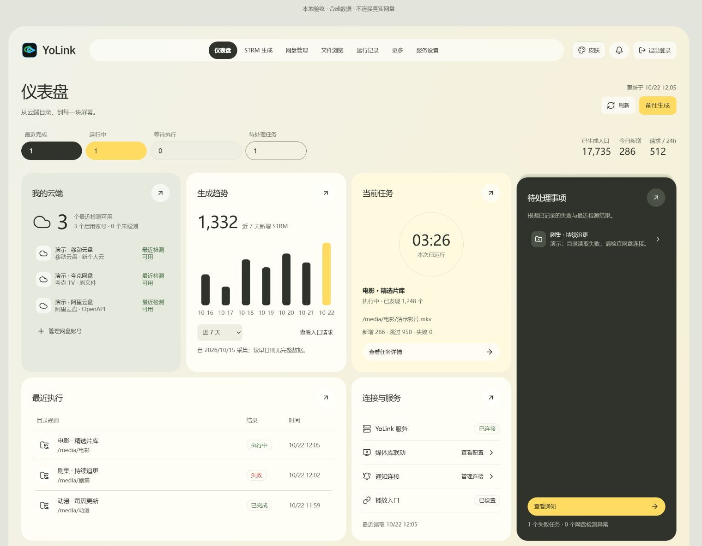
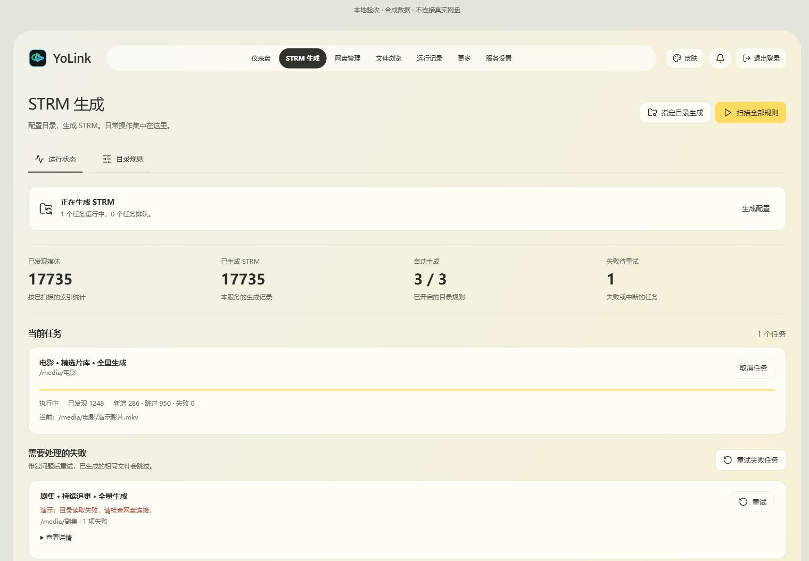
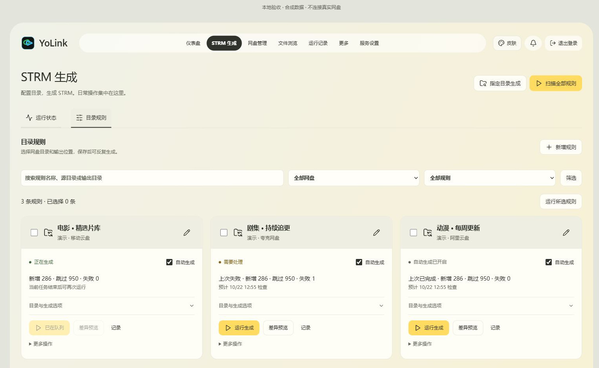
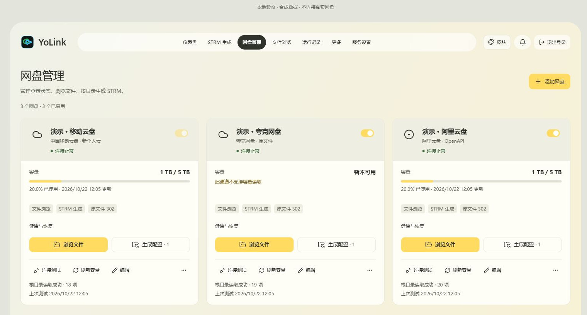
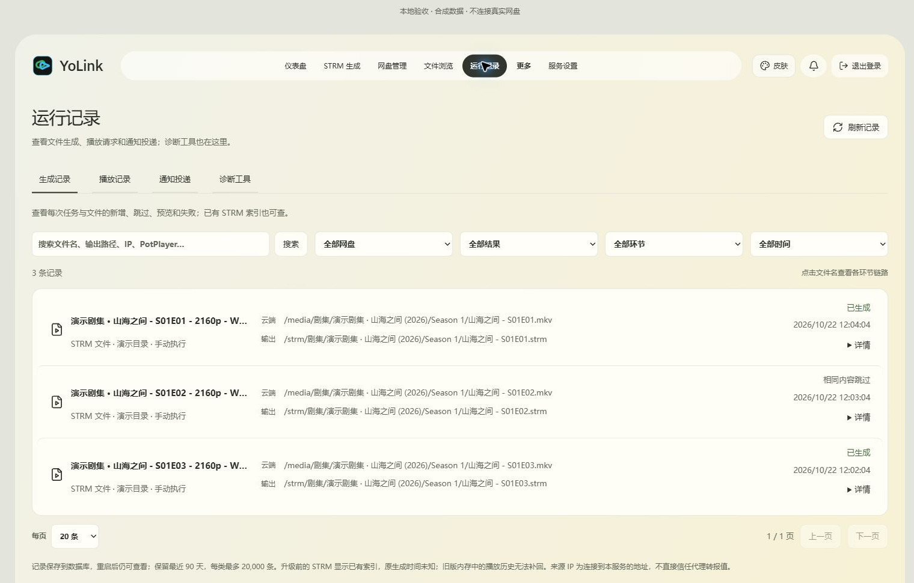

<p align="center">
  
</p>

<h1 align="center">YoLink</h1>

<p align="center"><strong>连接网盘与播放器，让云端媒体走进你的媒体库。</strong></p>

<p align="center">
  面向 NAS 的 STRM 生成与网盘播放入口服务<br>
  Go + SQLite · 单容器运行 · 桌面与手机可用
</p>

<p align="center">
  <a href="https://github.com/yyhoworks/YoLink/releases/latest"></a>
  <a href="https://hub.docker.com/r/yyhoworks/yolink"></a>
  <a href="https://github.com/yyhoworks/YoLink/actions/workflows/ci.yml"></a>
  <a href="LICENSE"></a>
</p>

<p align="center">
  <a href="#界面预览">界面预览</a> ·
  <a href="#主要功能">主要功能</a> ·
  <a href="#快速部署">快速部署</a> ·
  <a href="QUICKSTART.md">使用指南</a> ·
  <a href="https://github.com/yyhoworks/YoLink/releases">版本下载</a>
</p>

YoLink 直接接入**移动云盘、夸克、阿里云盘和 115**，按目录规则生成本地 STRM 文件，供 Emby、Jellyfin、Kodi 等媒体库读取。播放时，由稳定的签名入口解析网盘临时地址，按通道返回 302 跳转，或在明确允许后通过服务器中转。媒体原文件保留在网盘。

运行时只需要一个 Go 程序，网页和 SQLite 随服务提供，单容器即可运行，默认端口为 **8796**。当前版本为 **0.14.1**，源码、Docker 镜像和 Release 程序包均已公开。

## 界面预览

**运行仪表盘**：集中查看网盘状态、生成趋势、当前任务与待处理事项。

[](docs/images/dashboard.jpg)

| 生成工作台 | 目录规则 |
| --- | --- |
| [](docs/images/generation.jpg) | [](docs/images/rules.jpg) |
| 查看执行进度，处理失败任务。 | 按目录配置生成范围与执行计划。 |
| **网盘管理** | **运行记录** |
| [](docs/images/accounts.jpg) | [](docs/images/records.jpg) |
| 检查连接、查询容量、进入文件浏览。 | 按文件、结果与时间追溯执行情况。 |

> 截图来自项目界面的隔离只读演示，账号、路径和统计均为合成数据。点击图片可放大查看。

## 主要功能

| 能力 | 说明 |
| --- | --- |
| 多网盘接入 | 导入已有凭据，测试连接、按通道查询容量，浏览和筛选云端文件。 |
| STRM 生成 | 支持全量、指定目录、定时及入库事件触发；可预览、试生成、取消、断点恢复和失败重试。 |
| 观测与变更核对 | 对比目录观测与本地登记，减少重复生成；核对新增、改名、来源缺失和本地变化。仍需读取范围内的完整云端目录。 |
| 播放入口 | 使用稳定签名地址，播放时解析临时下载链接；提供 302、按通道选择的中转及 M3U 播放列表导出。 |
| 字幕与媒体资料 | 可选复制匹配的外挂字幕、NFO 和图片；相同内容跳过，不覆盖不同内容的已有文件。 |
| 账号健康与诊断 | 分别记录目录、解析与容量状态；选择受影响任务恢复，分步骤检查播放链路并导出脱敏报告。 |
| 记录与联动 | 查看生成、播放、诊断及通知记录；支持 Emby/Jellyfin 刷新和 Webhook/Telegram 通知。 |
| 备份与维护 | 手动加密备份、隔离校验与恢复；预览并确认缺失 STRM 修复、播放入口更新及旧 STRM 迁移。 |
| 外观与设备 | 原版/毛玻璃风格、六套配色、本地及 HTTPS 在线壁纸，适配桌面和手机。 |

### 支持的网盘通道

| 网盘 | 接入与播放方式 |
| --- | --- |
| 移动云盘 | 新/旧个人云通道，解析原文件下载地址后 302。 |
| 夸克 TV | 原文件 302，需要有效的 TV Token 与设备信息。 |
| 夸克网页 | Cookie 通道，需要明确允许服务器中转，媒体流量经过服务器。 |
| 阿里云盘 | OpenAPI 通道，通过下载接口解析后 302。 |
| 115 | Cookie + pickcode 获取原文件直链，默认 302，详见 [115 接入说明](docs/115-cookie.md)。 |

各通道的可用性取决于账号授权、权益、风控与网盘接口。YoLink 导入已有凭据，不提供扫码/短信登录或公共 OAuth 应用。

## 快速部署

### Docker Compose

需要 Docker Engine 和 Docker Compose。当前官方镜像支持 **linux/amd64**；Release 同时提供 Linux amd64、arm64 程序，其他镜像架构可自行构建。

在 Docker 主机上执行：

```sh
git clone https://github.com/yyhoworks/YoLink.git
cd YoLink
cp .env.example .env
mkdir -p ./data ./strm-test
sudo chown -R 10001:10001 ./data ./strm-test
docker compose pull
docker compose run --rm --no-deps yolink check-permissions
docker compose up -d --no-build
```

以上使用默认的专属目录和 UID/GID `10001:10001`，root 终端可省略 `sudo`。自定义输出目录或 `YOLINK_UID`/`YOLINK_GID` 时，请先按实际设置授予目录权限。NAS 共享目录可使用 ACL；不要直接对共享媒体库递归改属主。旧版本升级请先阅读 [升级与备份](QUICKSTART.md#升级与备份)。

Compose 默认拉取 `yyhoworks/yolink:0.14.1`。需要从源码构建镜像时，使用支持 BuildKit/Buildx 的 Docker，执行 `docker compose build` 后再启动；构建过程需要访问 Go 模块和基础镜像源。

### 第一次使用

1. 浏览器打开 `http://你的NAS-IP:8796`，使用 `data/initial-admin-password.txt` 中的首次随机管理员密码登录。
2. 在服务设置填写**媒体服务器和播放器能够访问的 YoLink 地址**。
3. 添加网盘凭据并测试连接，浏览一个较小的媒体目录。
4. 保存目录规则，选择独立输出位置，先预览或试生成少量文件。
5. 将 STRM 输出目录加入媒体库，在实际播放器中试播并验证拖动。本地播放器也可使用导出的 M3U 播放列表。

### 挂载与升级

| 默认主机目录 | 容器目录 | 内容 |
| --- | --- | --- |
| `./data` | `/data` | 数据库、加密凭据、服务密钥和管理员认证资料。 |
| `./strm-test` | `/strm` | 生成的 STRM 与可选字幕、媒体资料。 |

规则填写**容器内路径**。输出卷需要支持同卷硬链接；额外挂载、NAS ACL 和端口调整见 [快速开始](QUICKSTART.md#端口与挂载)。

升级前备份并保留数据目录、密钥、输出目录、`.env` 和 Compose override。数据库与密钥应一起备份；更改服务地址后，需要通过维护工具预览、核对并备份，才能更新已有 STRM。

## 文档导航

| 你想做什么 | 文档 |
| --- | --- |
| 安装、首次生成、调整挂载或升级 | [快速开始](QUICKSTART.md) |
| 接入 115 网盘 | [115 Cookie 通道](docs/115-cookie.md) |
| 接入 Telegram 指令与通知 | [Hermes Telegram 插件](docs/hermes-telegram.md) |
| 理解观测对比、变更核对和缺失修复 | [增量观测与场景模板](docs/incremental-sync.md) |
| 导出备份、校验与恢复 | [加密备份与恢复](docs/backup-restore.md) |
| 开发、构建前端或运行检查 | [开发说明](docs/DEVELOPMENT.md) |
| 查看本版变化和升级要求 | [0.14.1 更新说明](docs/release-0.14.1.md) · [全部 Release](https://github.com/yyhoworks/YoLink/releases) |
| 查看依赖和素材来源 | [第三方说明](THIRD_PARTY.md) |

<details>
<summary>历史版本说明</summary>

- [0.14.0：增量观测、变更核对与场景模板](docs/release-0.14.0.md)
- [0.13.0：加密备份与恢复](docs/release-0.13.0.md)
- [0.12.0：账号健康与播放诊断](docs/release-0.12.0.md)
- [0.11.11 更新说明](docs/release-0.11.11.md)
- [0.11.10 更新说明](docs/release-0.11.10.md)

</details>

## 常见问题

**媒体流量会经过 NAS 吗？** 302 通道由播放器跟随跳转访问网盘地址；显式开启服务器中转时，媒体流量会经过服务器。具体取决于网盘通道与账号配置。

**会覆盖或删除已有文件吗？** 生成过程跳过相同内容，保留不同内容的已有文件并报告冲突，不自动删除用户文件。修复、迁移和入口更新使用各自的预览与确认流程。

**自检可读就代表能播放吗？** 有限取流检查只说明服务端本次能读取少量媒体数据；302 表示跳转已发送。播放器解码、音轨、跨网访问与拖动仍需实际验证。

**可以自动转存或刮削吗？** YoLink 不提供订阅、转存、刮削或整部媒体下载，专注于 STRM 生成、播放入口和相关维护。

## 许可与分发

项目按 [GNU AGPL-3.0](LICENSE) 分发，包含从 OpenList 改编的实现。来源与依赖许可见 [THIRD_PARTY.md](THIRD_PARTY.md)。向获得镜像/程序的用户提供对应版本的源码，并遵守许可证对修改、分发和网络交互的要求。

部署者自己的网盘账号、数据库、密钥、访问令牌、备份和私人部署记录不属于仓库内容。请勿将这些资料上传到 Issue、讨论或公开日志。
